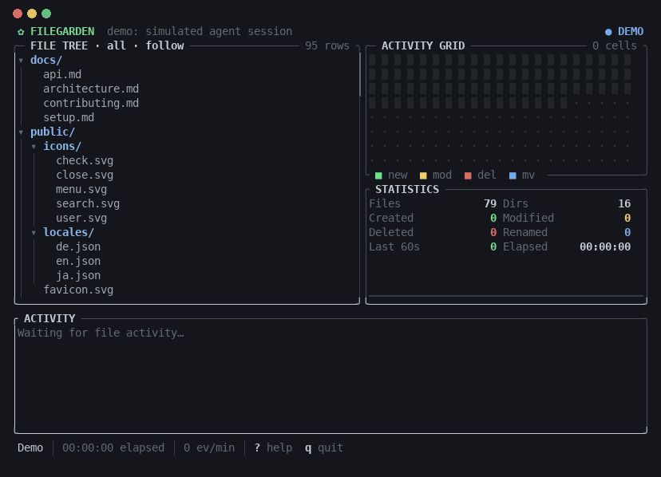
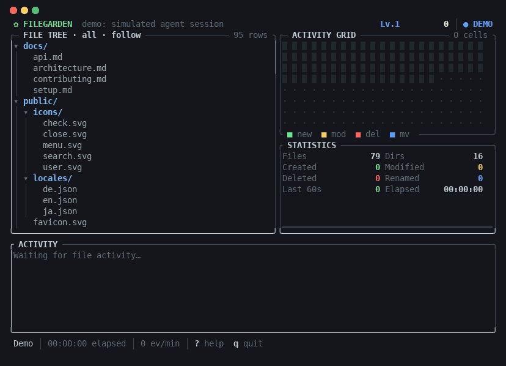

# FileGarden

**Watch your code grow.**

FileGarden is a terminal app that shows files being created, modified, deleted and renamed in a
directory as it happens. Start it in one terminal, run Claude Code, Codex, an editor or a build in
another, and watch the tree come alive: new files glow green, edits flash yellow, deletions turn
red and fade out, moves shine blue. A defrag-style **Activity Grid** gives every file a block that
lights up when it changes.



- **No integration needed.** FileGarden watches the file system, so it works with any AI agent,
  editor or tool, with or without Git.
- **Read-only.** It reads directory listings and file metadata only. It never opens file
  contents, never writes, and never touches the network.
- **Light.** A single static binary. ~0% CPU when idle, about 13 MB of memory for 10,000 files.
- **Game mode** (`--fx` or `x`): particles, floating points, combos, levels and achievements
  for when calm isn't the point.

## Install

### Prebuilt binaries

Download the archive for your platform from the [Releases page](../../releases), extract it and
put `filegarden` (`filegarden.exe` on Windows) somewhere on your `PATH`.

| Platform              | Archive                                     |
| --------------------- | ------------------------------------------- |
| Linux x64             | `filegarden-x86_64-unknown-linux-musl.tar.gz`  |
| Linux ARM64           | `filegarden-aarch64-unknown-linux-musl.tar.gz` |
| macOS (Apple Silicon) | `filegarden-aarch64-apple-darwin.tar.gz`       |
| macOS (Intel)         | `filegarden-x86_64-apple-darwin.tar.gz`        |
| Windows x64           | `filegarden-x86_64-pc-windows-msvc.zip`        |

Linux binaries are statically linked and run on any distribution. On macOS, a binary downloaded
through a browser may need `xattr -d com.apple.quarantine filegarden` before the first run.

### From source

Requires Rust 1.84 or newer.

```bash
cargo install --path .        # from a checkout
```

## Usage

```bash
filegarden                    # watch the current directory
filegarden watch .            # same
filegarden watch ~/projects/my-app
filegarden watch . --exclude "*.log" --exclude tmp/
filegarden watch . --poll     # network drives, WSL /mnt/*, some containers
filegarden watch . --no-animation
filegarden demo               # simulated AI-agent session; touches no files
filegarden demo --fx          # ...as a game
```

The screen has four parts:

- **File tree** (left): the directory, updated live. A marker shows what happened to each file
  (`+` created, `~` modified, `-` deleted, `→` renamed) and `×N` counts repeated edits. Changed
  files flash, then fade back to normal over about two seconds. Directories glow softly when
  something inside them changes, and collapsed directories open automatically so you can see the
  change. In **follow** mode (the default) the view scrolls to keep the latest change in sight.
- **Activity Grid** (top right): one block per file, defrag style. Blocks keep their position;
  when the grid is full, a newly active file takes over the block that has been quiet the
  longest. Files that change often stay faintly warm, so hot spots become visible over time.
- **Statistics** (bottom right): current file and directory counts, created / modified /
  deleted / renamed since start, events in the last 60 seconds with a one-minute sparkline, and
  elapsed time. Files present at startup are not counted as created.
- **Activity feed** (bottom): the latest changes with time stamps. Consecutive saves of the same
  file are merged into one line (`×3`).

On small terminals the feed, statistics and grid are dropped in that order; the footer then shows
compact counters.

### Game mode

Press `x` (or start with `--fx`) to turn your agent's work into an arcade game:



- lit grid cells burst into sparks, and deleted entries **shatter** letter by letter and fall
  out of the tree;
- every change scores points (`+100` create, `+25` modify, `+75` delete, `+150` rename, more
  for directories), floating up from the file that changed;
- changes less than 2.5 s apart build a **combo** that multiplies points, with NICE! / GREAT! /
  AWESOME!! / UNSTOPPABLE!!! banners and rainbow **FEVER** borders from 50×;
- levels, LEVEL UP fireworks, screen shake on big bursts and directory deletions, and
  achievement toasts (Seedling, Reaper, Demolition, Marathon, ...).

Score, level and combo are shown in the header. Game mode is off by default and unavailable with
`--no-animation`.

### Keys

| Key                   | Action                                  |
| --------------------- | --------------------------------------- |
| `q` / `Esc` / `Ctrl+C`| Quit                                    |
| `↑` `↓` (`k` `j`)     | Move the selection (leaves follow mode) |
| `PgUp` `PgDn`         | Move by a page                          |
| `Home` `End`          | First / last entry                      |
| `←` `→` (`h` `l`)     | Collapse / expand a directory           |
| `Enter`               | Toggle a directory                      |
| `f`                   | Follow the latest change again          |
| `Space`               | Pause / resume the display              |
| `r`                   | Rescan the directory                    |
| `a`                   | All files / only files that changed     |
| `x`                   | Game mode on / off                      |
| `?`                   | Help                                    |

Pausing freezes the picture, including fades. Changes keep being recorded and appear when you
resume.

### Options

```
filegarden [watch] [PATH] [OPTIONS]

  -e, --exclude <PATTERN>    Exclude paths matching a glob (repeatable)
      --no-default-excludes  Do not exclude .git, node_modules, target, ... by default
      --poll                 Poll instead of using native OS events
      --poll-interval <MS>   Polling interval [default: 1000]
      --debounce <MS>        Event aggregation window [default: 100]
      --resync <SECS>        Full re-synchronisation interval, 0 disables [default: 60]
      --fx                   Game mode: particles, combos, score (toggle with x)
      --no-animation         No fades: changes stay highlighted for 3 s, then switch off
      --no-color             No colors (NO_COLOR is honored too)
      --ascii                ASCII symbols only
      --colors <MODE>        auto | truecolor | 256 | 16 [default: auto]
  -h, --help                 Help
  -V, --version              Version

filegarden demo [--seed <N>] [--speed <X>] [display options]
```

**Exclude patterns.** A pattern without `/` matches a file or directory name anywhere
(`node_modules`, `*.log`). A pattern containing `/` is relative to the watched root
(`docs/generated/`). Excluding a directory excludes everything below it.

Excluded by default: `.git`, `node_modules`, `target`, `.next`, `dist`, `build`, `vendor`,
`.venv`, `coverage`, and editor swap/backup files (`*.swp`, `*~`, `.#*`, JetBrains temp files,
`.DS_Store`). Use `--no-default-excludes` to see everything; `--exclude` adds to whichever set is
active.

**Colors and symbols** adapt to the terminal: 24-bit color when `COLORTERM` says so (and on
Windows), 256 or 16 colors otherwise, and ASCII when the locale is not UTF-8.

## Supported platforms

| OS      | Backend                               | Notes                               |
| ------- | ------------------------------------- | ----------------------------------- |
| Linux   | inotify (one watch per directory)     | x64 and ARM64                       |
| macOS   | FSEvents                              | Apple Silicon and Intel             |
| Windows | ReadDirectoryChangesW                 | Windows 10 or newer, x64            |
| any     | `--poll`: periodic metadata scan      | for file systems without events     |

## Performance

Measured on Linux (WSL2, ext4), AMD Ryzen 9 3900X, release build, with a generated project of
10,000 files in 200 directories (`cargo run --release --example bench`):

| Measurement                                   | Result                                       |
| --------------------------------------------- | -------------------------------------------- |
| Initial scan of 10,200 entries                | 60 ms                                        |
| File change → logical event (60 samples)      | median 100 ms, p95 101 ms, max 101 ms        |
| Change → on screen                            | ≤ 135 ms (event + at most one 33 ms frame)   |
| Burst of 5,000 new files                      | written in 345 ms, all delivered by 441 ms   |
| CPU while idle (30 s, 10,000 files)           | ~0.07% (2 scheduler ticks in 30 s)           |
| CPU under ~190 writes/s for 10 s              | ~5% of one core                              |
| Memory (RSS) with 10,000 files                | 13 MB                                        |

The event latency is dominated by the 100 ms aggregation window (`--debounce`), which is what
turns bursts of OS notifications into one change per file. Lower it for snappier updates at the
cost of more split-up bursts.

## How it works

```
 OS events ──► watcher thread ──────────────────────────► UI thread
 (notify)      Aggregator: batch 100 ms, then re-check     AppState: tree, feed,
               every touched path against its own model    stats, visualization
               of the tree → CREATE/MODIFY/DELETE/RENAME   Ratatui: ≤30 fps while
                                                           animating, 1 fps idle
```

Raw OS events are treated as hints. When a batch closes, each touched path is compared with what
FileGarden knew before: present-then-absent is a delete, absent-then-present a create, and so on.
This makes the result the same on every platform and handles the awkward cases:

- an editor's "write a temp file, rename it over the original" save is one **modify**;
- dozens of events from one save are one change;
- a temp file that lives for a few milliseconds produces nothing;
- a new directory is scanned, so files written into it before the watch was set up still appear;
- renames are reported by the backend (Linux) or inferred from a delete and a create of the same
  name or size in the same batch (macOS, Windows).

Lost events are recovered by rescanning: when the OS reports an overflow, every 60 seconds
(`--resync`), and on `r`. A rescan compares sizes and modification times with the model and
emits whatever was missed. If the watched directory itself is deleted, the screen says so and
FileGarden picks up again when it reappears.

The code is split accordingly: `watcher/` (scanner, event conversion, aggregator, thread),
`state/` (tree, feed, statistics), `ui/` (panels, theme) and `viz/` (the `Visualization` trait and
the Activity Grid, so other visualizations can be added without touching the rest).

## Known limitations

- **Network file systems, WSL2 `/mnt/c`, Docker bind mounts on macOS/Windows** usually don't
  deliver change events. Use `--poll`. Polling rescans the whole tree every interval, so keep the
  interval reasonable for large trees.
- **Linux watch limit.** One inotify watch is used per (non-excluded) directory. If the limit is
  hit, FileGarden says so; raise it with
  `sudo sysctl fs.inotify.max_user_watches=524288` or use `--poll`.
- **Short-lived files** that are created and deleted within one aggregation window (100 ms) are
  not shown. This is deliberate: it hides editor and tool temp files.
- **Renames on macOS and Windows** are inferred. A rename whose two halves land in different
  batches appears as a delete plus a create.
- **Deleting a directory** is shown as one event for the directory, not one per file.
- **Symbolic links** are shown as entries but never followed.
- `.gitignore` is not read; use `--exclude`.
- The palette is tuned for dark terminal backgrounds.

## Development

```bash
cargo test                          # unit + end-to-end watcher tests (real file operations)
cargo run -- demo                   # synthetic activity, no file system involved
cargo run --release --example bench # performance numbers above
```

The end-to-end tests in `tests/watch.rs` create, modify, delete and rename files, write bursts of
1,000 files, build 40-level-deep trees, check exclusions, rescans, polling, and removal of the
watched root. Each test rebuilds the tree purely from the reported events and compares it with
the disk.

Releases are built by GitHub Actions when a `v*` tag is pushed (`.github/workflows/release.yml`).

## License

MIT
